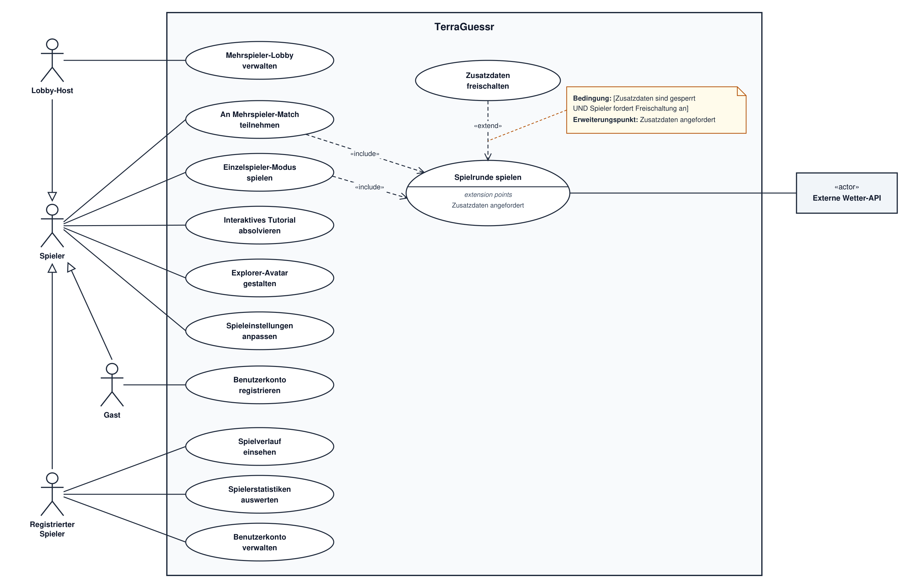

# Diagrammbeschreibung: Anwendungsfalldiagramm (TerraGuessr)

## Überblick und Systemgrenze

Das dargestellte UML-Anwendungsfalldiagramm beschreibt die wesentlichen funktionalen Anforderungen der Webanwendung **TerraGuessr** aus Sicht der beteiligten Akteure. Die Rechteck-Umrandung kennzeichnet die Systemgrenze von **TerraGuessr** und trennt die zwölf innerhalb des Systems angebotenen Anwendungsfälle klar von den fünf externen Akteuren, die außerhalb der Systemgrenze stehen.

## Akteure und Generalisierungsbeziehungen

Auf der linken Seite der Systemgrenze sind die vier menschlichen Primärakteure modelliert, die über Generalisierungsbeziehungen (jeweils dargestellt durch einen durchgezogenen Pfeil mit geschlossener, hohler Dreiecksspitze zum allgemeinen Akteur) zueinander in Beziehung stehen. Da Akteure in der UML **Rollen** und keine physischen Personen repräsentieren, kann dieselbe Person kontextabhängig mehrere Rollen einnehmen:

* **Spieler** bildet den allgemeinen Basisakteur für alle Nutzerinnen und Nutzer, die mit TerraGuessr interagieren.
* **Lobby-Host** ist eine Spezialisierung von **Spieler** entlang der Sitzungsrolle in Mehrspieler-Partien. Ein Lobby-Host erbt sämtliche Anwendungsfälle eines Spielers und übernimmt darüber hinaus die organisatorische Rolle für Mehrspieler-Lobbys (unabhängig davon, ob die Person parallel als Gast oder als registrierter Spieler agiert).
* **Gast** ist eine Spezialisierung von **Spieler** entlang des Authentifizierungsstatus. Er repräsentiert nicht authentifizierte Nutzerinnen und Nutzer, die sämtliche allgemeinen Spiel-, Lern- und Anpassungsfunktionen von **Spieler** erben und darüber hinaus ein neues Benutzerkonto anlegen können.
* **Registrierter Spieler** ist ebenfalls eine Spezialisierung von **Spieler** entlang des Authentifizierungsstatus. Dieser Akteur repräsentiert authentifizierte Nutzerinnen und Nutzer mit einem TerraGuessr-Benutzerkonto; er erbt alle grundlegenden Spiel- und Anpassungsfunktionen eines Spielers und erhält zusätzlich Zugriff auf kontogebundene Analyse-, Historien- und Verwaltungsfunktionen. Durch die Trennung der disjunkten Spezialisierungen **Gast** und **Registrierter Spieler** unterhalb des gemeinsamen Basisakteurs **Spieler** wird semantisch sauber modelliert, dass bereits registrierte Spielende den Anwendungsfall **Benutzerkonto registrieren** nicht erben. Gemäß gängigen UML-Modellierungsrichtlinien wird der reine Anmeldevorgang (*Login*) dabei nicht als eigenständiger Anwendungsfall ohne primären fachlichen Mehrwert modelliert, sondern als Authentifizierungs-Vorbedingung der Rolle **Registrierter Spieler** (bzw. im Rahmen der Sitzungs- und Kontoverwaltung) behandelt.

Auf der rechten Seite der Systemgrenze ist mit **Externe Wetter-API** (dargestellt als Klassifikator-Rechteck mit dem UML-Schlüsselwort `«actor»`) ein sekundärer Systemakteur modelliert, der von TerraGuessr während des Anwendungsfalls **Spielrunde spielen** zur Abfrage aktueller Wetterdaten für den jeweiligen Zielort eingebunden wird.

## Anwendungsfälle der Akteure

Der Basisakteur **Spieler** ist direkt mit fünf allgemeingültigen Anwendungsfällen assoziiert, die unabhängig vom Kontostatus jedem Spielenden zur Verfügung stehen:

* Über **Einzelspieler-Modus spielen** (inklusive Auswahl des Schwierigkeitsgrads *Leicht*, *Mittel* oder *Schwer* sowie der Rundenanzahl vor Spielbeginn) und **An Mehrspieler-Match teilnehmen** (Beitritt zu einer bestehenden Lobby und synchrones Spielen der Runden gegen andere Teilnehmende) können die beiden zentralen Spielmodi genutzt werden.
* Über **Interaktives Tutorial absolvieren** können die grundlegenden Spielmechaniken (Interpretation der Wetterdaten, Ortsauswahl, Tippabgabe sowie Distanz- und Punkteberechnung) in geführten Übungsrunden interaktiv erlernt werden.
* Mit **Explorer-Avatar gestalten** lässt sich das Erscheinungsbild des eigenen 3D-Avatars individuell konfigurieren.
* Über **Spieleinstellungen anpassen** können persönliche Anwendungseinstellungen vorgenommen werden.

Aufbauend auf dieser Basis stehen den spezialisierten Akteuren rollenspezifische Anwendungsfälle zur Verfügung:

* Der **Lobby-Host** repräsentiert die organisatorische Rolle beim Hosten einer Mehrspieler-Partie und kann zusätzlich den Anwendungsfall **Mehrspieler-Lobby verwalten** ausführen (Anlegen und Konfigurieren der gemeinsamen Lobby, Festlegen des für alle Teilnehmenden verbindlichen Schwierigkeitsgrads sowie der Rundenanzahl, Starten eines Matches und Schließen der Lobby).
* Der **Gast** ist zusätzlich mit dem Anwendungsfall **Benutzerkonto registrieren** assoziiert, über den ein neues Benutzerkonto angelegt werden kann, um künftig die Rolle des **Registrierten Spielers** einzunehmen.
* Der **Registrierte Spieler** verfügt zusätzlich über drei kontogebundene Anwendungsfälle (wobei während der vom Basisakteur **Spieler** geerbten Spielmodi **Einzelspieler-Modus spielen** und **An Mehrspieler-Match teilnehmen** die Spielergebnisse automatisch für sechs Monate im Konto archiviert sowie Avatar- und Spieleinstellungen kontogebunden synchronisiert werden): Über **Spielverlauf einsehen** können gespeicherte Partien, Zielorte, abgegebene Tipps, Distanzen und Punktzahlen einschließlich der Match-Replay-Kartenansicht abgerufen werden. Über **Spielerstatistiken auswerten** lassen sich aggregierte Leistungskennzahlen (z. B. nach Zeitraum, Spielmodus und Schwierigkeitsgrad) analysieren. Über **Benutzerkonto verwalten** können Authentifizierungs- und Profildaten (Anzeigename, Passwort, E-Mail-Adresse) verwaltet sowie das Benutzerkonto dauerhaft gelöscht werden.

## `«include»`-Beziehungen

Um den gemeinsamen, verpflichtenden Kernablauf der verschiedenen Spielmodi redundanzfrei abzubilden – ohne das Diagramm durch funktionale Dekomposition in elementare Einzelschritte zu zerlegen –, nutzt das Diagramm zwei `«include»`-Beziehungen (gestrichelte Pfeile mit offener Pfeilspitze vom einbindenden zum eingebundenen Anwendungsfall) zum wiederverwendeten Anwendungsfall **Spielrunde spielen**:

* Sowohl **Einzelspieler-Modus spielen** als auch **An Mehrspieler-Match teilnehmen** binden verpflichtend den Anwendungsfall **Spielrunde spielen** ein, da der zentrale Rundenablauf (Bereitstellung des zufälligen Zielorts unter Wahrung der Geheimhaltung bis Rundenende, Abruf der aktuellen Wetterdaten über den sekundären Akteur **Externe Wetter-API**, Ortsauswahl auf Karte oder Auswahlliste, Tippabgabe nach dem Best-of-N-Prinzip sowie Auswertung von Haversine-Distanz und Punktzahl einschließlich abschließender Auflösung des Zielorts) in beiden Spielmodi gleichermaßen durchlaufen wird.

## `«extend»`-Beziehung

Eine optionale, vom Spielenden ausgelöste und an eine fachliche Bedingung geknüpfte Erweiterung des regulären Rundenablaufs wird über eine `«extend»`-Beziehung (gestrichelter Pfeil mit offener Pfeilspitze vom erweiternden Anwendungsfall zum Basis-Anwendungsfall) zu **Spielrunde spielen** modelliert. Der zugehörige Erweiterungspunkt ist gemäß UML-2.5-Standard im durch eine horizontale Trennlinie abgetrennten Abschnitt *extension points* innerhalb des Anwendungsfalls **Spielrunde spielen** ausgewiesen, und die Eintrittsbedingung ist über eine angehängte UML-Notiz an der Erweiterungsbeziehung spezifiziert:

* **Zusatzdaten freischalten** erweitert **Spielrunde spielen** am Erweiterungspunkt *Zusatzdaten angefordert* unter der Bedingung `[Zusatzdaten sind gesperrt UND Spieler fordert Freischaltung an]`. Die Erweiterung tritt somit nur ein, wenn die zusätzlichen Hinweis- und Wetterdaten im gewählten Schwierigkeitsgrad (Mittel oder Schwer) zu Rundenbeginn gesperrt sind und die spielende Person deren Freischaltung gegen Punkteabzug (100 Punkte auf Mittel) bzw. Zeitstrafe (20 Sekunden auf Schwer) aktiv anfordert.
